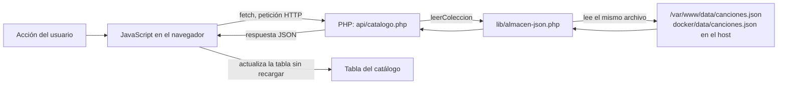

# Bloque 14 · Entender la nueva petición

## Recorrido de una consulta



El navegador ejecuta el JavaScript y presenta la tabla. PHP se ejecuta en el
contenedor y es el único que lee o modifica los datos. El archivo JSON está fuera
de `src`: el volumen de Compose monta `docker/data` como `/var/www/data`.
Las dos APIs comparten ese archivo y las funciones de `lib/almacen-json.php`;
no se debe crear otra copia del catálogo.

## Contrato de las direcciones

### `api/canciones.php`

Es la API que utiliza el reproductor. Con una sesión válida devuelve directamente
la lista de canciones, conservando el formato que ya consume la home:

```json
[
  {
    "id": 1,
    "title": "Título",
    "artist": "Artista",
    "src": "audio/cancion.mp3"
  }
]
```

Si no hay una sesión válida, responde con HTTP 401 y JSON de error:

```json
{"error": "No autenticado"}
```

No se debe envolver la respuesta correcta en `ok` o `data`: cambiarla rompería
el reproductor.

### `api/catalogo.php`

Es la API de gestión que utilizará el CRUD AJAX. Las operaciones correctas
responden con un objeto que contiene `ok: true` y la lista actualizada en `data`:

```json
{"ok": true, "data": []}
```

Si la petición no está autorizada o una operación falla, responde con un objeto
`ok: false` y un mensaje en `error`, además del estado HTTP apropiado:

```json
{"ok": false, "error": "Debes iniciar sesión."}
```

La respuesta de error no incluye una lista nueva. Los métodos y los campos de
cada operación de gestión se concretarán al implementar el CRUD AJAX.

## Acceso de páginas y APIs

La página privada está pensada para navegarse desde el navegador: si falta la
sesión, puede redirigir a `login.php` con HTTP 303. Una API se consume como datos,
por lo que debe informar el acceso denegado con un estado HTTP de error y JSON,
sin redirigir ni devolver el HTML del formulario de login. Ambas superficies
deben comprobar la sesión; cambia el formato de la respuesta para que cada
cliente pueda gestionarla correctamente.

Si `fetch` recibe HTML de login y el código intenta ejecutar
`response.json()`, el análisis JSON falla: HTML no es JSON. Por eso la API debe
devolver JSON también en los errores y el JavaScript debe comprobar el estado de
la respuesta y el campo `ok`.
