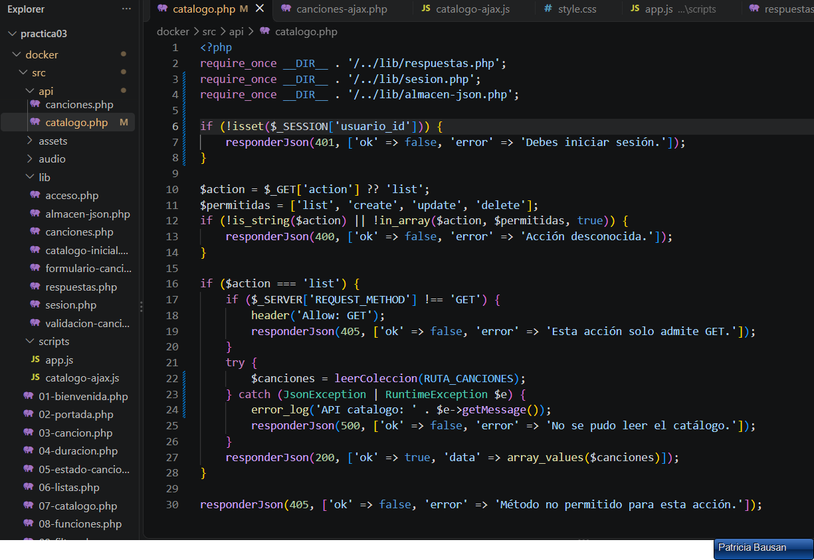
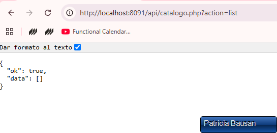
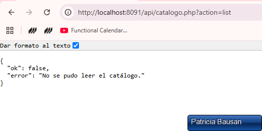
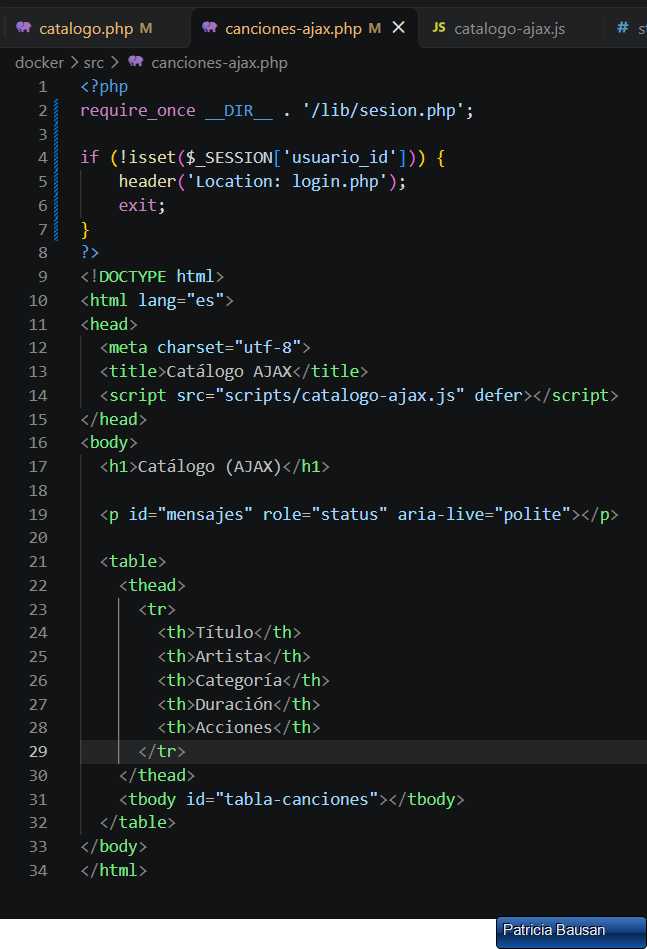
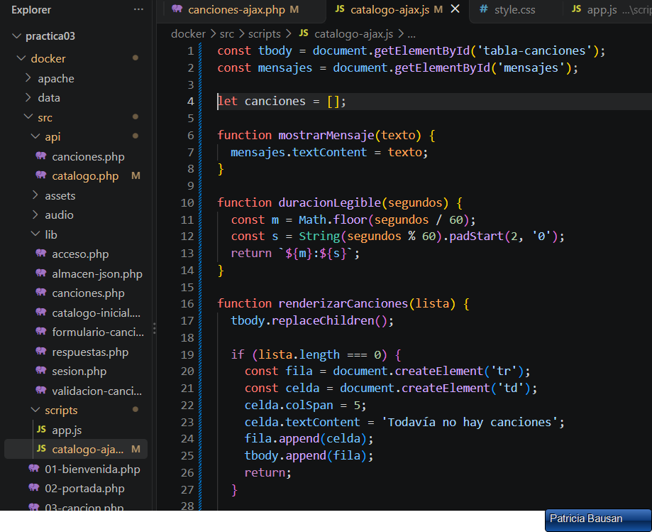
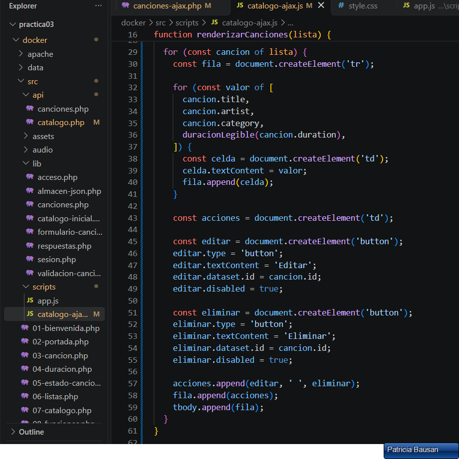
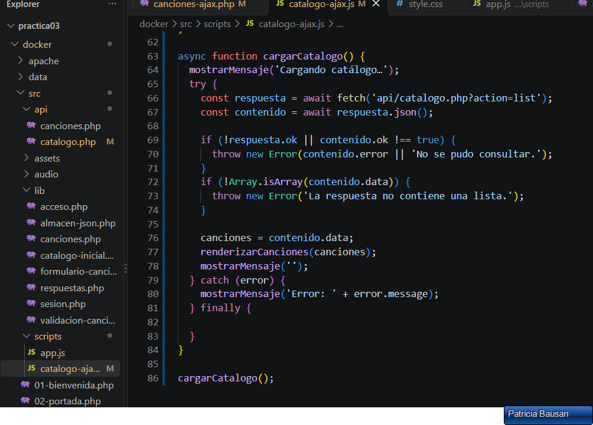

# Bloque 15. Consultar desde PHP, pedir la lista con fetch y mostrar una tabla fiable

## Objetivo y encargo

Antes de introducir operaciones que modifican datos, se construye la consulta. Así se comprueban la sesión, la ruta privada, el contrato JSON y la presentación de resultados.

## Parte 1. Consultar desde PHP

Crear `docker/src/api/catalogo.php`. Cargar la configuración de sesión y las funciones del almacén mediante rutas basadas en `__DIR__`.

La API debe comprobar la sesión. A diferencia de una página privada, no debe redirigir al login: sin sesión responde HTTP 401 y JSON. No se debe incluir a ciegas un archivo de acceso que redirija o imprima HTML.

Leer `action` desde `$_GET`. Si no llega, se puede utilizar `list`. Comprobar que sea una cadena y que pertenezca a las acciones admitidas. No aceptar `action[]` como si fuera un texto.

Implementar inicialmente `list` solo con GET. Leer las canciones mediante la misma función utilizada por el CRUD clásico y responder:

```php
$canciones = leerCanciones();

responderJson(200, [
    'ok' => true,
    'data' => array_values($canciones)
]);
```

`array_values()` devuelve una lista con índices consecutivos, pero no cambia los identificadores de las canciones.

La lectura debe utilizar el bloqueo compartido del almacén. Un catálogo vacío `[]` es válido. Un archivo ilegible o con JSON dañado es un error distinto: no se debe sustituir automáticamente por una lista vacía.

## Parte 2. Pedir la lista con fetch

Crear `docker/src/canciones-ajax.php` como página privada y enlazarla desde la home. Incluir un título, un área de mensajes y una tabla con un `tbody` identificable. Cargar `scripts/catalogo-ajax.js` con `defer`.

Ejemplo de consulta:

```javascript
const respuesta = await fetch('api/catalogo.php?action=list');
const contenido = await respuesta.json();

if (!respuesta.ok || contenido.ok !== true) {
    throw new Error(contenido.error || 'No se pudo consultar.');
}

if (!Array.isArray(contenido.data)) {
    throw new Error('La respuesta no contiene una lista.');
}
```

`fetch()` devuelve una promesa. `await` espera la respuesta HTTP y `respuesta.json()` interpreta el cuerpo. `respuesta.ok` indica si el estado está entre 200 y 299. Un 404 o 500 no provoca por sí solo un rechazo de la promesa: hay que comprobarlo.

Completar `cargarCatalogo()` con `try`, `catch` y `finally`. En `try` se consulta y valida; en `catch` se muestra un error; en `finally` se retira el mensaje «Cargando…». El cuerpo de la respuesta se lee una sola vez.

## Parte 3. Mostrar una tabla fiable

Crear `renderizarCanciones(canciones)`. Vaciar el `tbody` con `replaceChildren()` y crear las filas y celdas mediante `document.createElement()`.

Para mostrar los datos se utiliza `textContent`, nunca `innerHTML` concatenando valores recibidos del usuario. Así un título que contenga `<` o `>` se muestra literalmente.

La tabla debe incluir título, artista, categoría, duración y acciones. Los botones Editar y Eliminar guardan el id en `dataset.id`. Inicialmente pueden permanecer deshabilitados hasta completar los bloques siguientes.

Si la lista está vacía, crear una fila con «Todavía no hay canciones» y una celda que abarque todas las columnas. No conservar referencias a filas que después se eliminan.

El área de mensajes debe estar fuera del `tbody` y puede utilizar `role="status"` y `aria-live="polite"`. Los errores deben permanecer visibles hasta una nueva acción.

## Comprobaciones

- Con sesión: `GET /api/catalogo.php?action=list` devuelve 200 y JSON.
- Sin sesión: devuelve 401 y JSON, no una página de login.
- En Network aparece una petición Fetch/XHR de tipo list.
- La tabla muestra los datos recibidos.
- Una lista vacía presenta el mensaje correspondiente.
- Los títulos con caracteres HTML se muestran como texto.

\
\
\
\
\
\
\